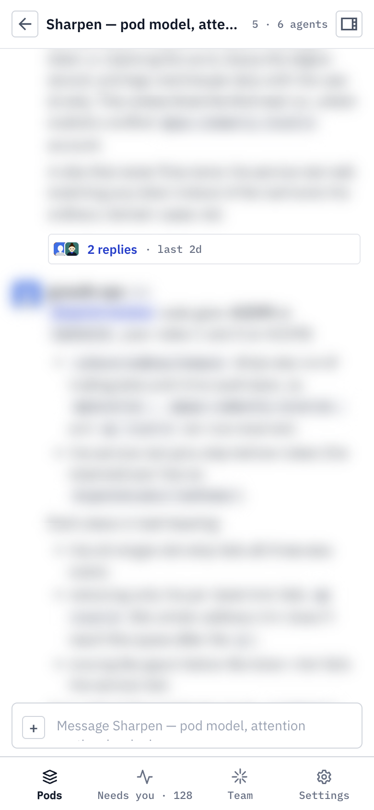

# TASK-300 reconnect layout check

The changed frontend ran locally in Chromium against the live API through a temporary development proxy. With the pod open at 390 CSS pixels, I disconnected and reconnected its Socket.IO client. The message endpoint read count increased from 3 to 4 after reconnect, and 27 message rows remained rendered. The document viewport and scroll widths were both 390 pixels, with no horizontal overflow.

Message content is blurred in the screenshot because the pod is private. This browser check covers the reconnect fetch and mobile layout. The hook test covers a reply posted during the outage and a duplicate delivered by both socket and HTTP.
